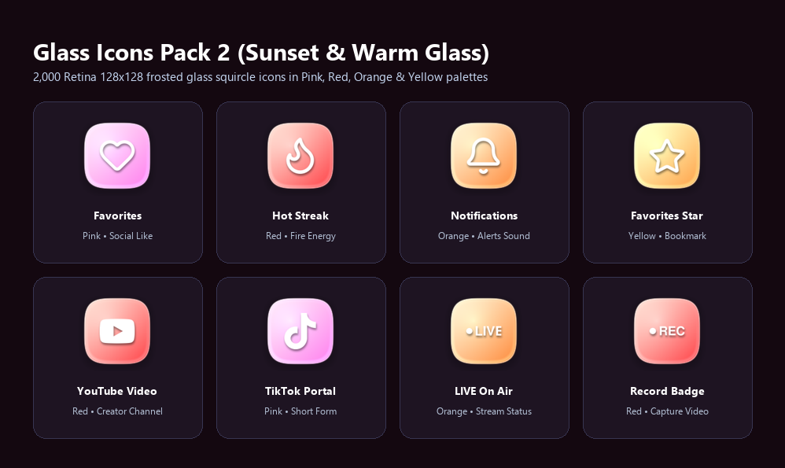
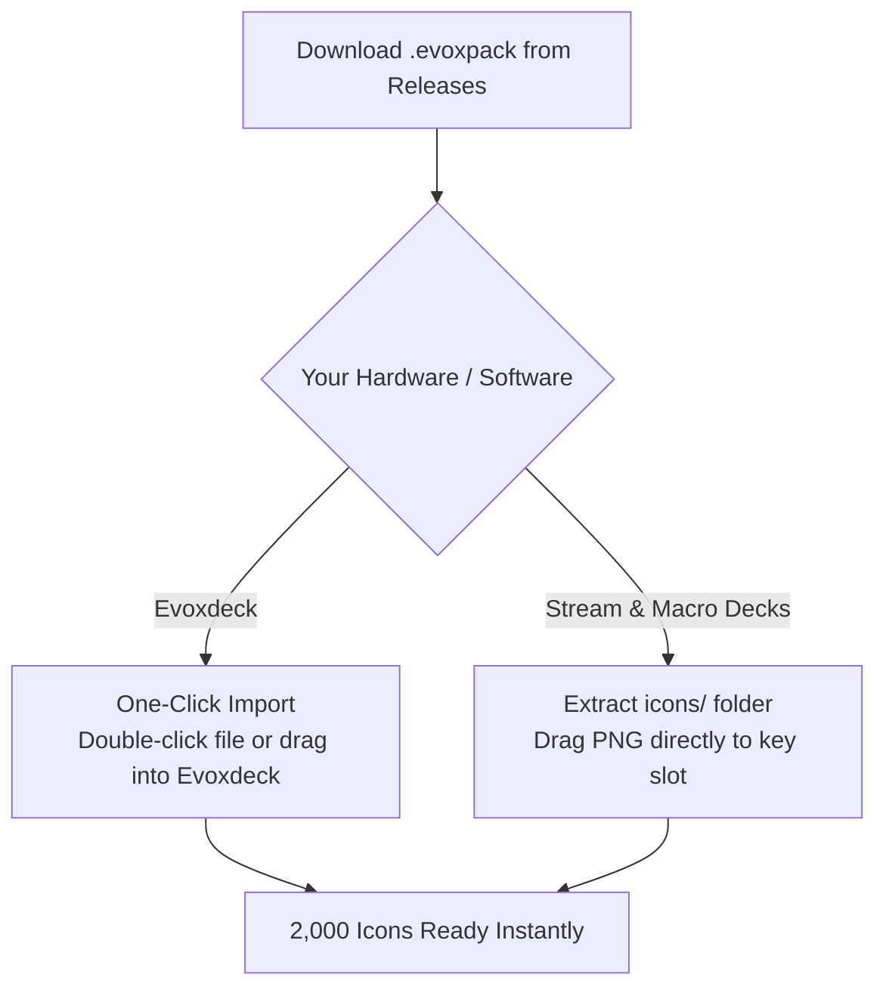

  
  <h1>Glass Icons Pack 2 (Sunset & Warm Glass)</h1>
  
<strong>2,000 radiant frosted glass squircle icons in Pink, Red, Orange & Yellow palettes for Stream Deck & Evoxdeck.</strong>

  

    <strong>Language:</strong> <a href="README.md"><strong>EN</strong></a> | <a href="README.tr.md"><strong>TR</strong></a>
    &nbsp;•&nbsp;
    <a href="https://github.com/Hfatih/glass-icons-pack-2/releases/latest">Download .evoxpack</a> ·
    <a href="https://hfatih.github.io/glass-icons-pack-2/">Live Interactive Gallery</a> ·
    <a href="#quick-installation">Installation Guide</a>
  

  

    
    
    
    
    
    
  

  

    
    
    
    
    
  

---

## Overview

**Glass Icons Pack 2 (Sunset & Warm Glass)** is a premium physical frosted glass icon collection handcrafted for **Stream & Macro Decks**, **Evoxdeck**, **Loupedeck**, and **Touch Portal** controllers.

Every icon is precision-rendered at Retina $128\times 128$ resolution using an advanced superellipse squircle formula ($p=3.65, r=53$), top-left diffuse light refraction (*specular bloom*), internal bottom rim lighting, and tactile 3D embossed glyphs.

### 🌐 Live Interactive Gallery & Deck Simulator
Browse all 2,000 icons, search keywords, switch colors, and test keys live in your browser:
👉 **[Open Live Gallery on GitHub Pages](https://hfatih.github.io/glass-icons-pack-2/)**

---

## Showcase Preview

| Stream Deck Hardware Showcase |
| :---: |
|  |
| *Frosted glass tiles with pure white embossed vectors and 3D depth shadows.* |

---

## Color Palettes Included

| Palette Name | Slug | Top-Left RGB | Bottom-Right RGB | Hex Gradient |
| :--- | :--- | :--- | :--- | :--- |
| **Pembe (Pink)** | `pink` | `rgb(255, 226, 241)` | `rgb(254, 125, 238)` | `#ffe2f1` ➔ `#fe7dee` |
| **Kırmızı (Red)** | `red` | `rgb(255, 218, 206)` | `rgb(254, 62, 68)` | `#ffdac6` ➔ `#fe3e44` |
| **Turuncu (Orange)** | `orange` | `rgb(255, 237, 206)` | `rgb(252, 136, 56)` | `#ffedce` ➔ `#fc8838` |
| **Sarı (Yellow)** | `yellow` | `rgb(255, 255, 196)` | `rgb(254, 158, 68)` | `#ffffc4` ➔ `#fe9e44` |

---

## Icon Categories (500 Symbols × 4 Themes)

1. **🎙️ Audio & Voice:** Mic, Headphones, Volume Levels (0-1-2-Mute), Sound Waves, Mixer, Radio.
2. **🎵 Media & Playback:** Play, Pause, Record, Fast-Forward, Rewind, Shuffle, Repeat, Camera, Video, 4K, HD.
3. **⭐ Streamer Badges:** REC, LIVE, Game Audio, Mic On, Mute, AFK, GG, VIP, MOD, Clutch, Sub, Chat.
4. **🎮 Gaming & Esports:** Minecraft, Valorant, League of Legends, Steam, OBS, Discord, Twitch, Gamepad, Joystick.
5. **📱 Apps & Socials:** YouTube, Twitch, Spotify, TikTok, Twitter/X, Instagram, Kick, Reddit, Telegram, WhatsApp.
6. **⚙️ Hardware & System:** CPU, GPU, RAM, Monitor, Laptop, Keyboard, Mouse, Bluetooth, WiFi, Power, Settings.

---

## Quick Installation

### 1. Evoxdeck (Recommended)
1. Download `Glass Icons Pack 2.evoxpack` from [Latest Releases](https://github.com/Hfatih/glass-icons-pack-2/releases/latest).
2. Double-click the file or navigate to **Evoxdeck** ➔ **Settings** ➔ **Icon Packs** ➔ **Import Pack**.
3. All 2,000 icons appear instantly with full search and tags.

### 2. Stream & Macro Decks
1. Extract the `icons/` folder from the repository or `.evoxpack` container.
2. Drag and drop any PNG onto your Stream Deck key slot.

---

## Package Specification (`manifest.json`)

The `.evoxpack` conforms strictly to the **Evoxdeck Package Specification v1**:
- `schemaVersion`: `1`
- `packageType`: `icon_pack`
- `coverImage`: `cover.png` (512×512 Retina squircle)
- `assets/icons/`: 2,000 individual PNG icons ($128\times 128$ px, 32-bit RGBA)

---

## License

Distributed under the **MIT License**. Free for personal and commercial stream setups.
Authored with 💖 by **[Fatih Han](https://github.com/Hfatih)**.
